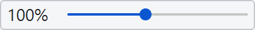

# RePDF — Read the PDF

[繁體中文](README.md) | [English](README.en.md)

RePDF 代表 **Read the PDF**，命令與 Python 套件名稱為 `repdf`。這是一套桌面 PDF 閱讀器，支援多標籤閱讀、列印、書籤與目錄跳頁、文字搜尋、選字複製、OCR 及圖片擷取，也可勾選頁面，依標籤與頁面排列順序重組或拆分輸出。重組與拆分保留原始頁面品質。

## 重點特色

- **支援規則表達式的搜尋**：可搜尋目前、勾選或所有標籤頁，並切換規則表達式、區分大小寫及僅限單字。點選搜尋結果即可跳到對應頁面，並以螢光筆效果標示命中文字。
- **直接擷取 PDF 內嵌圖片**：以滑鼠點選內嵌的點陣圖片，即可另存為 PNG，保留圖片的原始像素尺寸與透明度，不受閱讀時的縮放比例影響。

## 安裝與啟動

### 1. 下載發布的執行檔／App（建議）

從 [GitHub Releases](https://github.com/codemee/repdf/releases/latest) 下載適合平台的檔案，不需要安裝 Python 或 uv：

- **Windows x86_64**：下載 `repdf-<版本>-windows-x86_64.exe`，直接執行。
- **macOS Apple Silicon（arm64）**：下載 `repdf-<版本>-macos-arm64.dmg`，開啟後將 `RePDF.app` 拖入 Applications，再從 Applications 啟動。

- Release 同時提供 SHA256 校驗檔。
- 桌面套件已包含 OCR 執行環境與內建多語言模型；其他語言可在首次選用時下載，之後離線辨識。
- 目前未設定 Windows 程式碼簽章或 macOS Developer ID 簽章／公證，下載後可能出現系統安全提示。

### 2. 使用 uv tool 安裝

已有 [uv](https://docs.astral.sh/uv/) 時，可從 PyPI 安裝到獨立工具環境：

```powershell
uv tool install repdf
repdf
```

- 需要 Python 3.11 以上版本；uv 可在需要時下載適用的 Python。
- 也可使用 Release 的 `repdf` wheel 下載網址安裝。
- 若終端機找不到 `repdf`，執行 `uv tool update-shell` 後重新開啟終端機。

## 操作方式

工具列按鈕的圖示與用途如下；將游標停在按鈕上也可查看 tooltip。

| 工具列圖示／控制元件 | 功能 | 操作說明 | 快捷鍵 |
| --- | --- | --- | --- |
| <picture><source media="(prefers-color-scheme: dark)" srcset="docs/images/toolbar-open-dark.png"></picture> | 開啟 PDF | 一次選取多個 PDF，也可從檔案總管拖入。 | <kbd>Ctrl</kbd>+<kbd>O</kbd> |
| <picture><source media="(prefers-color-scheme: dark)" srcset="docs/images/toolbar-print-dark.png"></picture> | 列印 | 設定頁面範圍、縮放與印表機，預覽確認後列印。 | Windows／Linux：<kbd>Ctrl</kbd>+<kbd>P</kbd>；macOS：<kbd>⌘</kbd>+<kbd>P</kbd> |
| <picture><source media="(prefers-color-scheme: dark)" srcset="docs/images/toolbar-export-dark.png"></picture> | 重組輸出 | 將選取頁面依目前順序合併為一個新 PDF，指定檔名與儲存位置。 | <kbd>Ctrl</kbd>+<kbd>S</kbd>／<kbd>Ctrl</kbd>+<kbd>Shift</kbd>+<kbd>S</kbd> |
| <picture><source media="(prefers-color-scheme: dark)" srcset="docs/images/toolbar-split-dark.png"></picture> | 拆分輸出 | 將選取頁面依目前順序逐頁存成獨立 PDF，指定基本檔名與儲存位置。 | — |
| <picture><source media="(prefers-color-scheme: dark)" srcset="docs/images/toolbar-odd-dark.png"></picture> | 單數頁 | 選取或取消目前標籤的原始單數頁；部分選取時顯示三態標記。 | — |
| <picture><source media="(prefers-color-scheme: dark)" srcset="docs/images/toolbar-even-dark.png"></picture> | 雙數頁 | 選取或取消目前標籤的原始雙數頁；部分選取時顯示三態標記。 | — |
| <picture><source media="(prefers-color-scheme: dark)" srcset="docs/images/toolbar-copy-text-dark.png"></picture> | 複製文字 | 啟用後拖曳選取文字，放開滑鼠即複製到剪貼簿；選取的文字會顯示高亮。 | — |
| <picture><source media="(prefers-color-scheme: dark)" srcset="docs/images/toolbar-ocr-region-dark.png"></picture> | 區域 OCR | 拖曳矩形框選頁面或圖片，放開滑鼠後辨識並複製文字。 | — |
| <picture><source media="(prefers-color-scheme: dark)" srcset="docs/images/toolbar-extract-image-dark.png"></picture> | 擷取圖片 | 啟用後點選內嵌點陣圖片，再選擇位置另存為 PNG。 | — |
| <picture><source media="(prefers-color-scheme: dark)" srcset="docs/images/toolbar-bookmarks-dark.png"></picture> | 書籤 | 在左側章節樹展開或收合書籤，點選章節即可跳頁。 | — |
| <picture><source media="(prefers-color-scheme: dark)" srcset="docs/images/toolbar-search-dark.png"></picture> | 搜尋文字 | 在右側窗格搜尋文字，上方選檔案、下方選命中段落，單擊即可跳頁並高亮。 | Windows／Linux：<kbd>Ctrl</kbd>+<kbd>F</kbd>；macOS：<kbd>⌘</kbd>+<kbd>F</kbd> |
| <picture><source media="(prefers-color-scheme: dark)" srcset="docs/images/toolbar-zoom-dark.png"></picture> | 顯示比例 | 滑桿調整 25%–200%；點擊比例回到 100%。鍵盤縮放每次調整 25 個百分點。 | 放大：<kbd>Ctrl</kbd>+<kbd>+</kbd>／<kbd>Ctrl</kbd>+<kbd>=</kbd>；縮小：<kbd>Ctrl</kbd>+<kbd>-</kbd>；100%：<kbd>Ctrl</kbd>+<kbd>0</kbd> |
| <picture><source media="(prefers-color-scheme: dark)" srcset="docs/images/toolbar-fit-dark.png"></picture> | Fit | 將目前單頁等比例縮放至預覽區；調整視窗大小時自動適應。拖動滑桿或使用縮放快捷鍵會回到手動比例。 | — |
| <picture><source media="(prefers-color-scheme: dark)" srcset="docs/images/toolbar-fullscreen-dark.png"></picture> | 全螢幕單頁 | 每次顯示一頁，依螢幕寬度或高度等比例填滿；可用頁面上方的核取方塊選頁。 | <kbd>F11</kbd> 開啟／返回；<kbd>Esc</kbd> 返回 |
| <picture><source media="(prefers-color-scheme: dark)" srcset="docs/images/toolbar-fullscreen-spread-dark.png"></picture> | 全螢幕對頁 | 依目前順序兩頁並排：第 1、2 頁一組，第 3、4 頁一組，以此類推；每頁可獨立勾選。 | <kbd>Esc</kbd>／<kbd>F11</kbd> 返回 |
| <picture><source media="(prefers-color-scheme: dark)" srcset="docs/images/toolbar-fullscreen-cover-dark.png"></picture> | 全螢幕封面＋對頁 | 目前順序的第一頁作為封面單獨顯示；第 2、3 頁一組，第 4、5 頁一組，以此類推；每頁可獨立勾選。 | <kbd>Esc</kbd>／<kbd>F11</kbd> 返回 |
| <picture><source media="(prefers-color-scheme: dark)" srcset="docs/images/toolbar-language-system-dark.png"></picture> <picture><source media="(prefers-color-scheme: dark)" srcset="docs/images/toolbar-language-zh-dark.png"></picture> <picture><source media="(prefers-color-scheme: dark)" srcset="docs/images/toolbar-language-en-dark.png"></picture> | 介面語言 | 點擊依序切換「跟隨系統 → 繁體中文 → English」，選擇會記住。 | — |
| <picture><source media="(prefers-color-scheme: dark)" srcset="docs/images/toolbar-theme-system-dark.png"></picture> <picture><source media="(prefers-color-scheme: dark)" srcset="docs/images/toolbar-theme-light-dark.png"></picture> <picture><source media="(prefers-color-scheme: dark)" srcset="docs/images/toolbar-theme-dark-dark.png"></picture> | 介面配色 | 點擊依序切換「跟隨系統 → 淺色 → 深色」，選擇會記住。 | — |

### 開啟與切換檔案

- 檔案以主檔名顯示在標籤頁；將游標停在標籤上可查看完整路徑。
- 視窗標題列顯示 `RePDF` 與版本編號。
- 再次開啟同一路徑的檔案，會切換到既有標籤。
- 各檔案獨立保留比例、捲動位置、選頁與頁面排序。
- 下一個標籤（Windows／Linux）：<kbd>Ctrl</kbd>+<kbd>Tab</kbd>。
- 上一個標籤（Windows／Linux）：<kbd>Ctrl</kbd>+<kbd>Shift</kbd>+<kbd>Tab</kbd>。
- 標籤依排列順序循環切換；焦點在預覽、頁面核取方塊或工具列控制項時也可使用。
- 關閉標籤：點標籤右側的 ×；Windows／Linux 可按 <kbd>Ctrl</kbd>+<kbd>W</kbd>，Windows 另支援 <kbd>Ctrl</kbd>+<kbd>F4</kbd>，macOS 為 <kbd>⌘</kbd>+<kbd>W</kbd>。
- 關閉按鈕的 tooltip 會顯示目前平台適用的快捷鍵。

### 開啟密碼保護的 PDF

1. 開啟檔案；若需要密碼，程式會顯示密碼對話框。
2. 輸入密碼並按確認；可勾選「顯示密碼」檢查輸入內容。
3. 密碼錯誤時可重新輸入；取消只略過該檔案，不影響同批開啟的其他檔案。

- 不需要密碼即可開啟的加密 PDF 會直接讀取。
- 解鎖後可閱讀、搜尋、列印、重組、拆分、複製文字、區域 OCR 與擷取圖片。
- 同一標籤開啟期間不再詢問；關閉後再次開啟需重新輸入。
- 密碼只在記憶體中使用，不儲存到設定檔或記錄。
- 重組與拆分產生的 **新 PDF 不加密**，輸出對話框會明確標示；原始檔案保持不變。

### 預覽與縮放

- 預覽頁面水平置中；Fit 使用單欄顯示。
- 大檔案優先顯示目前閱讀的頁面；跳頁時不必等待整份文件載入。
- 100% 對應 Windows 的 96 DPI 顯示尺度。
- Fit 與全螢幕優先使用最近點擊且仍可見的頁面；未指定時使用預覽區中央附近的頁面。
- Fit 的適應比例可超出滑桿的手動範圍，實際比例仍顯示於工具列。
- 滑桿的手動範圍為 25%–200%；完整縮放說明可查看比例按鈕的 tooltip。
- 全螢幕對頁以同一比例完整顯示兩頁，最後剩一頁時單獨顯示。
- 返回主視窗後，保留原有縮放比例。

### 鍵盤捲動與切頁

- 一般預覽：<kbd>←</kbd>、<kbd>↑</kbd>、<kbd>→</kbd>、<kbd>↓</kbd> 捲動畫面；<kbd>Page Up</kbd>／<kbd>Page Down</kbd> 捲動一個畫面。
- Fit 模式：上述按鍵依序切換上一頁／下一頁，以目前可見頁面為起點。
- Fit 模式到達第一頁或最後一頁時不會越界，反向按一次即可切頁。
- 全螢幕上一頁／上一組：<kbd>←</kbd>、<kbd>↑</kbd> 或 <kbd>Page Up</kbd>。
- 全螢幕下一頁／下一組：<kbd>→</kbd>、<kbd>↓</kbd> 或 <kbd>Page Down</kbd>。
- 跳至第一頁／最後一頁：<kbd>Home</kbd>／<kbd>End</kbd>，依目前頁面排列順序跳轉；全螢幕對頁與封面＋對頁則跳至第一組／最後一組。
- 以上按鍵在縮放滑桿或頁面核取方塊取得焦點時仍可操作預覽區，不會改動縮放比例。

### 頁碼與直接跳頁

- 狀態列右側顯示目前頁碼與總頁數，捲動或使用搜尋、書籤跳頁時會同步更新。
- PDF 有內建頁碼標籤時，會同時顯示書頁與原始頁次，例如「書頁 iii｜PDF 3 / 800」或「書頁 12｜PDF 20 / 800」。較長的標籤會截短，滑鼠停留可查看完整內容；沒有標籤時維持一般頁碼顯示。
- 書頁使用 PDF 提供的標籤，不以 OCR 推測，也不保證與頁面上印出的數字相同；跳頁輸入欄仍使用原始 PDF 頁次。
- 點頁碼欄輸入號碼，按 <kbd>Enter</kbd> 跳到指定頁；按 <kbd>Esc</kbd> 或離開輸入欄可取消尚未送出的輸入。
- 頁碼與頁面卡片上的原始頁碼一致；重新排序後，輸入同一頁碼仍會找到原本的頁面。
- 跳頁保留目前縮放／Fit 模式；輸入超出範圍或無效內容時會顯示提示，不會改變目前頁面。

### 列印

- 點列印圖示，或按 <kbd>Ctrl</kbd>+<kbd>P</kbd>（macOS：<kbd>⌘</kbd>+<kbd>P</kbd>），直接開啟整合列印視窗；全螢幕中使用快捷鍵會先返回主視窗。
- 選擇目前文件全部頁面、目前頁面、指定頁次或勾選頁面；指定頁次使用原始 PDF 頁碼，例如 `1,3,5-8`。
- 勾選頁面沿用輸出規則：有勾選標籤時使用這些標籤內勾選的頁面；沒有勾選標籤時使用目前標籤內勾選的頁面。
- 列印依目前標籤與頁面排列順序進行；列印視窗會顯示文件數與頁數。
- 預設符合可列印範圍，也可選實際大小；每張紙放一頁並置中，不自動旋轉。實際大小超出可列印範圍時會裁切。
- 左側可直接選擇印表機、紙張、方向、份數、逐份列印、雙面及色彩；雙面與色彩選項依印表機能力提供，調整紙張與範圍時會同步更新右側預覽。
- 右側可用前後頁圖示、頁次輸入欄或 <kbd>Page Up</kbd>／<kbd>Page Down</kbd> 翻頁，並選擇符合視窗或放大檢視。預覽只載入目前頁面，大文件不會一次渲染全檔。
- 預覽中的白色紙張依本次紙張尺寸與方向顯示，虛線表示可列印範圍；可切換符合範圍／實際大小，查看邊距與裁切效果。視窗縮窄時，設定與預覽改為上下排列，設定區可捲動。
- 僅需紙匣、列印品質或其他驅動專屬選項時，再按「進階設定」開啟系統交談窗；返回後設定會同步至預覽。若在系統交談窗另選頁次，使用本次列印清單的 `1..N`。
- 預覽顯示一份列印內容，份數另列於紙張資訊；確認後按「列印」才開始送印。關閉或取消預覽不會送印。
- 列印 PDF 內容，不包含搜尋高亮、選字標記或操作介面。
- 大文件逐頁處理，進度視窗可取消後續送印；已送出的頁面可能仍需從系統列印佇列取消。
- 沒有印表機時仍可預覽，列印按鈕會停用；實際送印前需先安裝或設定系統印表機，不需要額外安裝列印工具。

### 書籤與目錄跳頁

- 點工具列的「書籤」圖示開啟左側章節樹，可展開或收合子章節，點選章節即可跳頁。
- 書籤跟隨目前標籤頁切換；沒有內建書籤的文件會顯示提示。
- 一般預覽與全螢幕都可直接點選 PDF 頁內的目錄連結；滑鼠移到可跳頁區域時會顯示手指游標與目的頁碼。
- 跳頁保留目前縮放／Fit 模式。頁面已重新排序時，仍會找到目的章節所屬的原始頁面。
- 視窗縮窄時，書籤與 PDF 以單一窗格切換；點選章節後返回 PDF，再點「書籤」可返回目錄。搜尋與書籤窗格可透過各自的工具按鈕切換。
- 啟用複製文字、區域 OCR 或圖片擷取模式時，頁內連結暫停點選；停用後即可跳頁，拖曳頁面仍可排序。
- 一般預覽與全螢幕可點選 PDF 內建的 HTTP／HTTPS 超連結，以系統預設瀏覽器開啟；滑鼠停留可查看網址。
- 此功能使用 PDF 已有的書籤與連結；純文字或掃描圖片形式的目錄、網址不會自動變成連結。電子郵件、外部文件與其他動作不在支援範圍。

### 搜尋文字

1. 點「搜尋文字」或按 <kbd>Ctrl</kbd>+<kbd>F</kbd>（macOS：<kbd>⌘</kbd>+<kbd>F</kbd>），開啟右側窗格。
2. 輸入搜尋內容，選擇「目前標籤頁」、「勾選的標籤頁」或「所有標籤頁」；同一列的 `.*`、`Aa` 與底線 `ab` 狀態按鈕分別切換「規則表達式」、「區分大小寫」與「僅限單字」，亮起表示啟用。
3. 按 <kbd>Enter</kbd> 或「搜尋」執行；修改條件後再次執行才會更新結果。
4. 上方選取有命中的檔案，下方以交錯底色單行列出命中段落、原始頁碼與命中次數；內容過長時以 `...` 結尾，滑鼠停留可查看完整段落。
5. 單擊段落，切換到對應標籤與頁面，捲至命中位置；尚未載入的頁面會自動載入。命中預設以黃色螢光筆標示，選取段落以較深的同色系突出。

- 預設搜尋目前標籤頁、不區分大小寫、不使用規則表達式；三種範圍互斥。
- 「僅限單字」預設關閉；啟用後，命中內容兩側不能緊接 Unicode 字母、數字、底線或組合標記，例如 `cat` 不會命中 `catalog`。可與規則表達式併用；此選項不會替連續中文斷詞。
- 「勾選的標籤頁」沿用標籤左側的核取方塊；沒有勾選時會提示，不自動改搜目前檔案。
- 搜尋涵蓋範圍內已成功載入檔案的全部頁面，不受頁面勾選限制；密碼文件需先解鎖。
- 只搜尋既有文字層，不啟動 OCR；掃描圖片或損壞的文字層可能搜尋不到。
- 同段落內的多次命中合併為一筆；段落依文字行與版面位置推估，不跨頁搜尋，分欄及複雜版面可能有段落差異。
- 支援同一段落內的跨行搜尋：視覺換行會合併，中日文字之間不補空格，其餘續行以空格銜接；跨行命中會標示對應各行的文字。
- 規則表達式採 Python 相容語法；無效規則會顯示錯誤，零長度位置不列為可高亮的命中。
- 每段正則匹配最多 1 秒；逾時會停止搜尋並標示結果不完整。也可按「停止」保留目前已找到的結果。
- 可拖曳右側窗格寬度與上下結果區的分隔線；搜尋不改動選頁、排序或縮放模式。
- 視窗寬度小於 640px 時，搜尋與 PDF 改為單一窗格切換；點結果後顯示 PDF，再點搜尋按鈕可返回結果。
- 視窗較矮時，從三點「選項」選單調整範圍、規則表達式、區分大小寫與僅限單字設定。
- 點選搜尋選項列的色塊按鈕可設定命中標示顏色；較矮視窗可從「選項 → 命中標示顏色」開啟。變更會立即更新現有標示，無須重新搜尋，並套用至全螢幕與之後載入的頁面；選擇會記住，取消選色不會變更設定。
- 關閉搜尋窗格會停止搜尋並清除高亮，保留輸入與結果；文件關閉時會移除其結果。
- 全螢幕使用搜尋快捷鍵時，會返回主視窗並開啟搜尋窗格。

### 選頁與拖曳排序

- 點各頁左上角的核取方塊可個別選頁；核取方塊取得焦點後，也可按 <kbd>Space</kbd> 勾選。
- 全螢幕核取方塊會同步主視窗的選頁，返回後即可重組或拆分。
- 拖曳頁面縮圖或「拖曳排序」把手，可調整頁面順序。
- 拖曳時縮圖會跟隨游標，其他頁面以動畫移開並顯示插入空位。
- 移到頁面左半部插入其前方，右半部插入其後方。
- 放開滑鼠確認排序；按 <kbd>Esc</kbd> 取消。

### 重組與拆分輸出

- 標籤左側的核取方塊預設不勾選。
- 有勾選標籤：只輸出勾選檔案的已選頁面。
- 沒有勾選任何標籤：只輸出目前標籤的已選頁面。
- 勾選檔案沒有選頁時，不提供輸出頁面，也不會自動改選目前檔案。
- 拖曳標籤可調整檔案順序；輸出先依標籤順序，再依各檔內的頁面排序，未勾選的頁面不會輸出。
- 拆分指定 `report.pdf` 時，會輸出 `report_01.pdf`、`report_02.pdf` 等檔案。
- 拆分序號跨檔連續、從 1 開始，至少兩位；依本次輸出總數補零對齊，例如 100 頁使用 `001`–`100`，與原始頁碼無關。
- 已存在的單頁檔案會先詢問是否覆蓋。
- 密碼保護的 PDF 須先成功解鎖；輸出的新 PDF 不加密。

### 複製文字、區域 OCR 與擷取圖片

- 三種模式互斥；一般預覽與全螢幕皆可使用。
- 啟用時按鈕以 hover 底色與強調色圖示標示，不顯示外框；關閉後恢復拖放排序。
- 複製文字：啟用後拖曳選取，放開滑鼠即可複製；掃描影像中的文字請使用區域 OCR。
- 區域 OCR：啟用後拖曳矩形範圍，放開滑鼠後辨識並複製；空白範圍保留原剪貼簿。
- 擷取圖片：啟用後點選內嵌點陣圖片，再選擇位置另存為 PNG。
- 圖片保留原始像素尺寸並套用透明遮罩，不受預覽縮放影響。
- 輸出完整內嵌圖片，不套用頁面上的旋轉或裁切，也不包含周圍文字與向量圖形。
- 點到空白處會顯示提示；同一位置有多張圖片時，選取最後繪製的圖片。
- 掃描頁面通常會擷取整張掃描圖，無法從中直接分離照片或圖表。
- OCR 預設支援繁體中文、簡體中文、英文、日文及多種拉丁字母語言。點「區域 OCR」旁的箭頭，可選韓文、泰文、俄文／烏克蘭文、阿拉伯文與印地文／尼泊爾文；另提供希臘文、泰米爾文與泰盧固文。
- 選「自動＋已下載模型」可共用內建與已下載模型，逐行選擇辨識結果，不會自行下載其他模型。
- 語言選單以分隔線區分自動選項、已下載與未下載三組，不顯示群組標題；已下載的模型名稱後會標記「已下載」。模型下載、遺失或損壞後，分組與標記會自動更新。
- 額外模型會先顯示下載確認，下載完成才切換語言；取消或失敗保留原設定。語言設定會記住，並套用於區域 OCR 及損壞文字備援。辨識後請校對結果。完整操作與限制見 [OCR 說明](docs/OCR.md)。

## 語言與配色

工具列右側提供兩個三態按鈕，首次使用皆預設跟隨系統，點擊即可立即切換：

- 介面語言：跟隨系統 → 繁體中文 → English → 跟隨系統。系統顯示語言為中文時使用繁體中文，其他語言使用 English；tooltip 顯示目前模式與實際語言。
- 介面配色：跟隨系統 → 淺色 → 深色 → 跟隨系統。手動指定配色後不受系統配色變化影響，回到系統模式則即時跟隨。
- 深色配色採《新世紀福音戰士》初號機風格，以紫黑背景、紫色面板、螢光綠強調色及少量橙色呈現；PDF 頁面保留原始顏色。

- 語言與配色的選擇會記住，重新啟動仍保留。
- 切換語言會更新既有頁面標籤、工具列、tooltip、狀態與對話框。
- 切換語言不改動檔名、選頁、頁序或比例。
- 檔案選擇視窗的按鈕與欄位會跟隨指定的中英文語言。

## 其他文件

- [OCR 操作與限制](docs/OCR.md)
- [開發、測試與發布指南](docs/IMPLEMENTATION.md)
- [UI 設計參考](docs/UI_DESIGN.md)
